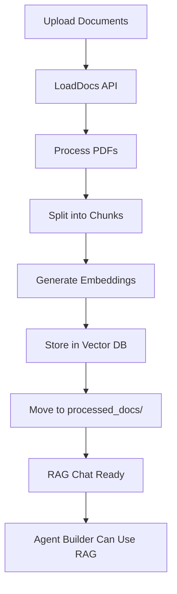
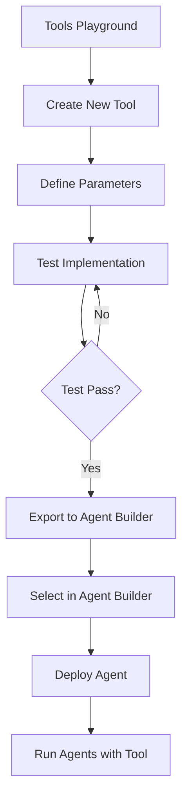
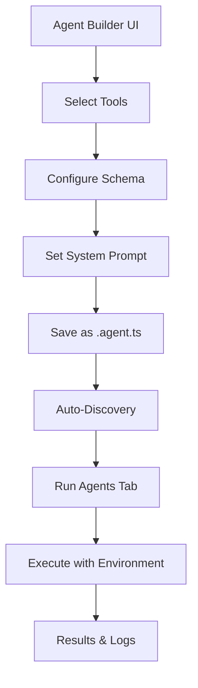

# Product Requirements Document (PRD) – Agent-Lab v4.0

## Overview
Agent-Lab is an experimental AI “Lego Set” that unifies:
- Modular agents
- RAG (retrieval-augmented generation)
- Local & cloud models
- A clean React/TypeScript UI

The goal is to provide a flexible sandbox for building and orchestrating AI agents with tools and workflows.

## Objectives
- Provide a unified environment for experimentation with AI agents
- Support both cloud models (OpenAI, Anthropic) and local models (GPT-2, MLX)
- Offer a visual Agent Builder UI for assembling agents from tools, schemas, and workflows
- Enable consistent agent structure via templates and a registry system
- Ensure safety when exposing system tools (CLI, web, etc.)

## Target Users
- Developers experimenting with multi-agent systems
- Researchers testing RAG/document Q&A setups
- Builders who want to visually compose AI workflows

## Key Features
- 3-tab UI: Agents, Chatbot, RAG Chat
- Agent Builder with metadata, tools, schemas, workflows
- Tool library (stock APIs, web scraping, CLI, etc.)
- Secure execution layer (filtered CLI tool)
- Persistent RAG vector store with ingestion + querying
- Extensible model layer (local/cloud/MLX-ready)

## Success Criteria
- Agents can be created via the UI and saved consistently
- Registry automatically detects and exposes new agents
- End-to-end workflow: query documents → analyze → output via agent
- Clear developer experience: modular, documented, reproducible

## System Flow Diagrams

### Document Ingestion Flow

### Tool Development & Testing Flow

### Agent Lifecycle Flow

